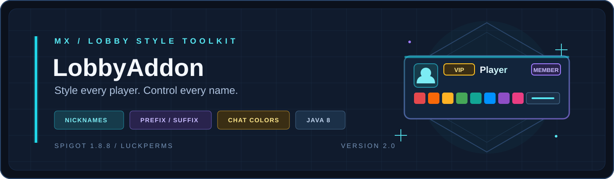

<div align="center">



**大厅玩家样式管理 · 昵称 / 称号 / 后缀 · 聊天颜色**


[下载插件](https://github.com/ImMengXin0/LobbyAddon/releases/latest) · [快速开始](#快速开始) · [命令参考](#命令参考) · [聊天颜色](#聊天颜色) · [源码构建](#源码构建)

</div>

---

LobbyAddon 是面向大厅服务器的玩家样式管理插件。玩家可以通过命令或 GUI 设置昵称、自定义称号、自定义后缀和聊天颜色，管理员可以配置审核流、冷却、长度限制、禁用词和持久化历史记录。

昵称、称号与后缀会同步到聊天、TabList 和头顶名；聊天颜色独立作用于玩家消息正文，支持传统 16 色、Hex 单色、双端渐变和文字格式。数据可保存在 YAML 或 MySQL，MySQL 模式下全部读写异步执行。

## 功能一览

| 能力 | 可以做什么 |
| --- | --- |
| 🏷️ 昵称 | 永久或临时昵称、别名查询、管理他人昵称、冷却与长度限制 |
| ✨ 称号与后缀 | 接入 LuckPerms 的自定义称号与后缀，后缀自动包裹灰色括号 |
| 🎨 聊天颜色 | 传统 16 色、Hex 单色、渐变、加粗/斜体/下划线/删除线/乱码与组合预设 |
| 🖥️ 图形菜单 | 昵称、称号、后缀、聊天颜色的分层个人菜单，以及配置化预设菜单 |
| 🛡️ 审核与历史 | 可选审核流、持久化待审核请求、修改历史查询 |
| 💬 显示同步 | 统一聊天、TabList、可选原生记分板头顶名，支持关闭后完整还原 |
| 🗄️ 存储 | 原子写入 YAML，或缓存优先、失败重试、定时同步的异步 MySQL |
| 🔌 协同 | PlaceholderAPI 占位符、BungeeCord 跨服人数、TAB / TrChat / LuckPerms 兼容 |

## 快速开始

### 运行环境

| 组件 | 要求 |
| --- | --- |
| 服务端 | Spigot / Paper **1.8.8** 及以上 |
| Java | **Java 8** 及以上 |
| LuckPerms | 自定义称号与后缀需要 |
| PlaceholderAPI | 可选，用于占位符与聊天格式 |
| TAB | 可选；若由 TAB 管理头顶名，请保持 `display.nametag.enabled: false` |

### 安装

1. 从 [最新 Release](https://github.com/ImMengXin0/LobbyAddon/releases/latest) 下载 `LobbyAddon-2.0.jar`。
2. 停止服务器，将 JAR 放入 `plugins/` 目录。
3. 启动服务器，让插件生成 `config.yml`。
4. 关闭服务器，按需修改存储方式、显示规则与限制。
5. 再次启动后执行 `/lobbyaddon info` 确认加载状态。

> [!IMPORTANT]
> 使用 MySQL 时请先建库并修改 `mysql` 配置节；首次从 YAML 迁移可临时开启 `mysql.migrate-yaml-on-first-load`，导入完成后必须恢复为 `false`。

### 第一次使用

```text
/nick 天宇                 设置永久昵称
/custom VIP                设置永久称号
/suffix 管理员             设置永久后缀（显示为灰色括号）
/chatcolor hex #12ABEF     设置聊天颜色
/cosmetics                 打开预设样式菜单
```

## 命令参考

### 玩家命令

| 命令 | 用途 |
| --- | --- |
| `/nick <昵称>` | 设置永久昵称 |
| `/nick temp <时长> <昵称>` | 设置临时昵称，例如 `/nick temp 1h 天宇` |
| `/nick reset` | 重置昵称 |
| `/nick <玩家> <昵称>` | 管理其他在线玩家的昵称，需要 `lobbyaddon.nick.others` |
| `/custom <称号>` | 设置永久称号 |
| `/custom temp <时长> <称号>` | 设置临时称号 |
| `/custom reset` | 重置称号 |
| `/suffix <后缀>` | 设置永久带括号后缀 |
| `/suffix temp <时长> <后缀>` | 设置临时带括号后缀 |
| `/suffix reset` | 重置后缀 |
| `/cosmetics` | 打开预设样式菜单 |
| `/chatcolor legacy <&0-&f或颜色名>` | 设置传统聊天颜色 |
| `/chatcolor hex <#RRGGBB>` | 设置 1.16+ Hex 单色；旧服按配置降级 |
| `/chatcolor gradient <#起始色> <#结束色>` | 设置逐字符渐变 |
| `/chatcolor format <格式> [on/off/toggle]` | 设置加粗、斜体、下划线、删除线或乱码 |
| `/chatcolor preset <名称>` | 应用配置中的颜色与格式组合预设 |
| `/chatcolor preview [文字]` | 预览当前聊天样式 |
| `/chatcolor reset` | 清除聊天颜色与格式 |
| `/realname <昵称>` | 查询昵称对应的真实玩家 |
| `/lobbyaddon menu` | 打开个人设置菜单 |

时长使用 `s`、`m`、`h` 或 `d`，例如 `30m`、`1h`、`7d`。上限由 `temporary.max-duration-seconds` 控制。

### 管理命令

| 命令 | 权限 | 用途 |
| --- | --- | --- |
| `/lobbyaddon reload` | `lobbyaddon.reload` | 重载配置并安全重建任务、存储和监听器 |
| `/lobbyaddon info` | `lobbyaddon.info` | 查看运行状态 |
| `/lobbyaddon debug` | `lobbyaddon.debug` | 查看档案、Bungee 和依赖诊断摘要 |
| `/lobbyaddon pending` | `lobbyaddon.approval.review` | 查看待审核申请 |
| `/lobbyaddon approve <编号>` | `lobbyaddon.approval.review` | 批准申请 |
| `/lobbyaddon reject <编号>` | `lobbyaddon.approval.review` | 驳回申请 |
| `/lobbyaddon history <玩家>` | `lobbyaddon.history` | 查看最近修改记录 |
| `/lobbyaddon papi` | `lobbyaddon.papi` | 列出全部受支持的 PlaceholderAPI 变量 |
| `/lobbyaddon menu` | `lobbyaddon.cosmetics.use` | 打开个人设置总菜单 |

### 权限节点

<details open>
<summary><strong>展开权限表</strong></summary>

| 权限 | 默认 | 用途 |
| --- | --- | --- |
| `lobbyaddon.nick.use` | 所有人 | 使用昵称功能 |
| `lobbyaddon.nick.color` | OP | 在昵称中使用颜色代码 |
| `lobbyaddon.nick.others` | OP | 管理其他在线玩家的昵称 |
| `lobbyaddon.nick.bypass` | OP | 绕过昵称长度限制 |
| `lobbyaddon.custom.use` | 所有人 | 使用自定义称号 |
| `lobbyaddon.custom.color` | OP | 在称号中使用颜色代码 |
| `lobbyaddon.custom.bypass` | OP | 绕过称号长度限制 |
| `lobbyaddon.suffix.use` | 所有人 | 使用自定义后缀 |
| `lobbyaddon.suffix.color` | OP | 在后缀中使用颜色代码 |
| `lobbyaddon.suffix.bypass` | OP | 绕过后缀长度限制 |
| `lobbyaddon.cosmetics.use` | 所有人 | 打开个人设置与预设样式菜单 |
| `lobbyaddon.chatcolor.use` | 所有人 | 使用聊天颜色系统 |
| `lobbyaddon.chatcolor.legacy` | 所有人 | 使用传统 16 色聊天颜色 |
| `lobbyaddon.chatcolor.hex` | 所有人 | 使用十六进制聊天颜色 |
| `lobbyaddon.chatcolor.gradient` | 所有人 | 使用渐变聊天颜色 |
| `lobbyaddon.chatcolor.format` | 所有人 | 使用聊天文字格式 |
| `lobbyaddon.chatcolor.preset` | 所有人 | 使用聊天颜色预设 |
| `lobbyaddon.chatcolor.obfuscated` | OP | 使用乱码聊天格式 |
| `lobbyaddon.nochat.bypass` | 无 | 绕过大厅禁言 |
| `lobbyaddon.reload` | OP | 重新加载插件配置和服务 |
| `lobbyaddon.info` | OP | 查看插件运行状态 |
| `lobbyaddon.debug` | OP | 查看插件诊断信息 |
| `lobbyaddon.history` | OP | 查看样式修改记录 |
| `lobbyaddon.approval.review` | OP | 审核玩家样式申请 |
| `lobbyaddon.papi` | OP | 查看受支持的 PAPI 变量 |

</details>

## 昵称、称号与后缀

- 后缀会自动包裹为灰色括号，例如 `&c&l天宇` 会显示为 `&7[&c&l天宇&7]`。
- 支持冷却、可见/原始长度限制、颜色权限、Unicode 规范化禁用词，以及按世界或子服限制。
- `profile-rules.disabled-worlds` 与 `profile-rules.disabled-servers` 可分别禁用昵称、称号或后缀。
- 昵称、称号和后缀中的 Hex 颜色代码仅在 Minecraft 1.16+ 渲染；旧版本会安全移除 Hex 代码。

## 显示与限制

| 配置项 | 作用 |
| --- | --- |
| `server-name` | 当前后端服在代理中的名称，用于 `disabled-servers`、`group-defaults.servers` 和 Bungee 本服人数回退，例如大厅服设为 `lobby` |
| `display.chat.format` | 聊天排列格式，使用 `{display}`（仅昵称/名字）与 `{message}`（聊天正文） |
| `display.tab-list.enabled` | 同步 TabList；为兼容 1.13，长文本会截断为 16 个可见字符 |
| `display.nametag.enabled` | 通过原生记分板 Team 同步头顶名；若 TAB 或其他插件管理 Team，请保持关闭 |
| `display.enabled` | 设为 `false` 会恢复原始显示名、TabList 和头顶名，并停止改写聊天、加入及死亡文本 |

聊天格式支持 PlaceholderAPI 的 `%identifier_placeholder%` 语法。示例：`%luckperms_prefix% {display} %luckperms_suffix% &f{message}`。

## 聊天颜色

`chat-color` 与 `display.chat` 相互独立：前者只负责玩家消息正文的颜色与格式，后者负责昵称、前后缀和消息的排列格式。玩家选择保存在插件数据目录的 `chat-colors.yml`，聊天事件只读内存缓存，写盘异步执行。

| 模块 | 命令示例 | 说明 |
| --- | --- | --- |
| 传统 16 色 | `/chatcolor legacy aqua` | 支持 `&0` 至 `&f` 以及英文颜色名 |
| Hex 单色 | `/chatcolor hex #12ABEF` | 六位十六进制颜色，1.16+ 真彩色 |
| 渐变 | `/chatcolor gradient #FF512F #F09819` | 使用起止两种颜色逐字符渐变 |
| 文字格式 | `/chatcolor format bold` | `bold`、`italic`、`underline`、`strikethrough`、`obfuscated` |

- 在 Minecraft 1.16+ 上显示真彩色；在 1.8-1.15 上默认逐色映射到最接近的传统 16 色，可通过 `chat-color.modern.legacy-fallback: false` 禁用降级。
- 玩家消息中自行输入的 `&a`、`§a`、`&#RRGGBB` 等控制码会被清除，实际样式只取决于保存的选择与权限。
- `chat-color.presets` 可配置单色、渐变、格式组合及每个预设的额外权限。
- 核心权限为 `lobbyaddon.chatcolor.use`、`.legacy`、`.hex`、`.gradient`、`.format`、`.preset` 和 `.obfuscated`，也可在 `chat-color.permissions` 中替换节点名称。

## 预设与权限组样式

`/lobbyaddon menu` 提供昵称、称号、后缀和聊天颜色的分层 GUI。昵称、称号、后缀支持永久设置、30 分钟、1 小时、1 天、重置和配置预设；聊天颜色支持传统 16 色、Hex、渐变、组合预设、文字格式、预览和重置。

自由文本会从玩家的下一条聊天输入读取，输入 `取消` 或 `cancel` 可以返回菜单；等待时间由 `personal-menu.input-timeout-seconds` 控制。`/cosmetics` 仍可直接打开原有预设菜单。

`presets.entries` 可以创建 GUI 样式项：

```yaml
presets:
  entries:
    vip-prefix:
      type: prefix
      value: '&6[VIP]'
      material: NAME_TAG
      name: '&6VIP 称号'
      lore: ['&7点击应用']
      slot: 11
      permission: lobbyaddon.preset.vip
      duration: 0
```

`group-defaults` 按顺序匹配权限、世界和子服，为没有自定义样式的玩家提供显示默认值：

```yaml
group-defaults:
  - permission: lobbyaddon.group.vip
    prefix: '&6[VIP]'
    suffix: '&7[会员]'
    worlds: []
    servers: []
```

## 审核与历史

将 `approval.enabled` 设为 `true`，并在 `approval.required-types` 中列出 `nick`、`prefix` 或 `suffix`。玩家的修改会保存为待审核申请，审核员批准后才会实际写入。

档案、临时过期时间、待审核申请和最近历史保存在插件数据目录的 `profiles.yml`。昵称仍按 `storage.type` 保存；使用 MySQL 时，玩家样式档案继续存放在 `profiles.yml`，避免 PAPI 和聊天事件访问数据库。

## 存储与 MySQL

MySQL 模式使用 HikariCP 连接池。所有 SQL 加载和写入均异步进行，命令、聊天、PAPI 和显示刷新只读取内存缓存。缓存首次加载完成前会拒绝昵称写操作；写入失败会保留待写数据并按 `mysql.cache-refresh-seconds` 重试，同时接收其他子服的昵称变化。

从 YAML 切换至 MySQL 的首次迁移可设置：

```yaml
mysql:
  migrate-yaml-on-first-load: true
```

仅在目标表为空时导入已有 `nicks.yml`，导入完成后应将该选项恢复为 `false`。`/lobbyaddon info` 和 `/lobbyaddon debug` 可查看存储加载及健康状态。

## PlaceholderAPI

可用占位符包括：

| 占位符 | 内容 |
| --- | --- |
| `%lobbyaddon_online%`、`%lobbyaddon_max_online%` | 当前总人数与上限 |
| `%lobbyaddon_online_<子服>%` | 指定子服人数 |
| `%lobbyaddon_bungee_status%` | `online`、`stale` 或 `disabled` |
| `%lobbyaddon_prefix%`、`%lobbyaddon_suffix%`、`%lobbyaddon_display%` | 当前称号、后缀与显示名 |
| `%nick_name%`、`%nick_realname%`、`%nick_hasnick%` | 昵称、真实名与是否设置昵称 |
| `%lobbyaddon_nick_temporary%` 等 | 昵称、称号、后缀是否为临时 |
| `%lobbyaddon_nick_expires_at%` 等 | 昵称、称号、后缀的过期时间 |
| `%lobbyaddon_nick_cooldown%` 等 | 昵称、称号、后缀的剩余冷却 |

执行 `/lobbyaddon papi` 可在游戏内列出全部受支持的变量。

## 源码构建

项目使用 **Gradle Wrapper 8.13**，无需全局安装 Gradle。

```powershell
.\gradlew.bat clean build --console=plain
```

构建成功后生成：

```text
build\libs\LobbyAddon-2.0.jar
```

JAR 已通过 `implementation` 内嵌 MySQL Connector/J 与 HikariCP，无需额外安装依赖。编译目标为 Java 8，可使用 JDK 8 及以上版本构建。

`build` 会执行 `check`，运行 `src/test` 下的单元测试，覆盖聊天颜色解析与渲染、样式策略与编解码、命令路由、配置默认值与校验、菜单输入与文本、档案请求、时长解析、旧版文本截断和原子 YAML 写入等场景。自动化测试不能替代 Minecraft 实服验收。

## 项目结构

```text
src/main/java/cn/mx/lobbyaddon/
├── LobbyAddon.java      # 插件入口
├── chat/                # 聊天颜色解析、渲染与样式策略
├── command/             # 玩家与管理命令
├── config/              # 配置默认值与完整校验
├── listener/            # 玩家事件、禁言和 GUI 点击
├── menu/                # 个人菜单与预设菜单
├── placeholder/         # PlaceholderAPI 扩展
├── profile/             # 档案、临时样式、审核与历史
├── service/             # 显示、LuckPerms、Bungee、菜单与昵称逻辑
├── storage/             # 缓存优先的 YAML / MySQL 昵称存储
└── util/                # 颜色、时长、限制与原子写入工具
src/main/resources/      # plugin.yml 与默认 config.yml
src/test/java/           # 单元测试
docs/                    # 菜单设计文档与素材
```

## 排错

| 问题 | 检查项目 |
| --- | --- |
| 插件无法加载 | 服务端版本是否不低于 1.8.8、Java 是否为 8+ |
| 称号或后缀不生效 | 是否已安装 LuckPerms，以及对应 `lobbyaddon.custom.use` / `.suffix.use` 权限 |
| 昵称无法写入 | MySQL 是否可用、缓存是否仍在首次加载，查看 `/lobbyaddon debug` |
| 头顶名重复或闪烁 | TAB 等插件是否也在管理 Team，保持 `display.nametag.enabled: false` |
| Hex 或渐变没有颜色 | 服务端是否 1.16+；旧版默认降级为传统 16 色 |
| 修改后未生效 | 执行 `/lobbyaddon reload`；存储类型变更需要完整重启 |
| 玩家输入控制码无效 | 这是预期行为，外部控制码会被清除，样式只由保存的选择决定 |

## 鸣谢

- 由 **ImMengXin** 开发维护。

---

本插件会改写玩家的显示名、TabList、头顶名和聊天格式。正式部署前，请务必在与生产服配置一致的测试环境中验证聊天、跨服人数与显示效果。

